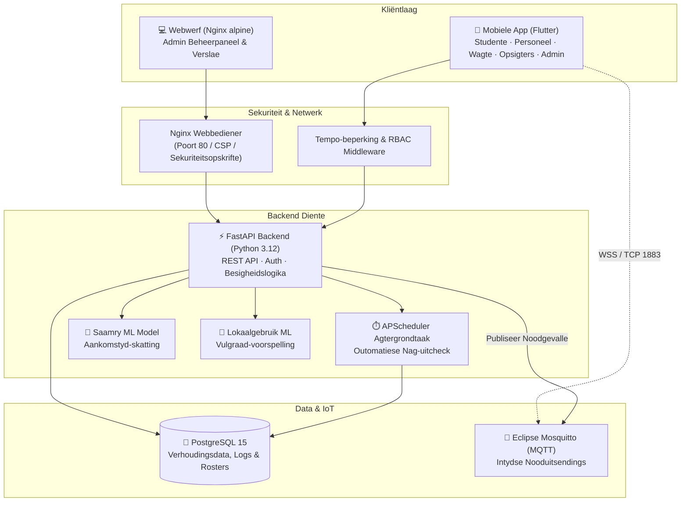

# MOON — Kampus Toegangsbeheer- & Veiligheidstelsel

> **NSWIW370 · 2026 · Span 3 — Finale Inhandiging (DA11)**

MOON (Modulêre Omvattende Operasionele Netwerk) is 'n geïntegreerde kampusbestuur-, toegangsbeheer- en veiligheidstelsel ontwikkel vir Akademia. Die platform kombineer kontaklose NFC-tegnologie, intydse IoT-boodskappe (MQTT), 'n intelligente Saamry-versoenbaarheidstelsel met masjienleer (ML), lokaalgebruikvoorspelling, noodontruimingsbestuur, en rol-gebaseerde sekuriteit in 'n eenvormige ekosisteem.

Die stelsel bedien vyf verskillende rolspelers (**Studente**, **Personeel**, **Kampus Opsigters**, **Sekuriteitswagte**, en **Sisteem Administrateurs**) deur middel van 'n multi-platform Flutter mobiele app en 'n responsiewe webkoppelvlak.

---

## Spansamestelling

| Lid | Rol | Kernverantwoordelikhede |
|---|---|---|
| **Jaco Oosthuizen** | Databasis & Projekleier | Databasisontwerp, migrasies, skedulering, projekkoördinering |
| **Louis** | Backend Ontwikkelaar | FastAPI Admin API, RBAC, sekuriteitsverharding, verslagdoening |
| **Steven** | Backend Ontwikkelaar | Toegangsbeheer, NFC-integrasie, MQTT noodgeval-diens |
| **Connor** | Frontend Ontwikkelaar | Webwerf admin-koppelvlak, temas, dinamiese dashboards |

---

## Stelselargitektuur

Die stelsel is gebou op 'n mikrodienste- en houer-gebaseerde argitektuur wat betroubaarheid, sekuriteit en intydse reaksie verseker:



---

## Tegniese Stapel

| Laag | Tegnologie | Beskrywing |
|---|---|---|
| **Mobiele App** | Flutter 3.x (Dart) | Kruisplatform-toepassing (Android & iOS) met NFC, QR, kaarte en agtergrond-MQTT |
| **Webkoppelvlak** | HTML5 / CSS3 / Vanilla JS | Skoon, vinnige administrasiepaneel bedien deur Nginx alpine |
| **Backend API** | FastAPI (Python 3.12) | Asinchrone REST API met Uvicorn, Pydantic v2 en SQLAlchemy ORM |
| **Databasis** | PostgreSQL 15 | Relasionele databasis met buitesleutel-integriteit en migrasieskripte |
| **IoT & Boodskappe** | Eclipse Mosquitto 2 (MQTT) | Hoëspoed boodskapdiens vir intydse kampuswye noodgevaluitsendings |
| **Masjienleer** | Scikit-Learn, Pandas, NumPy | Regressie- en mediaanheuristiek vir pendeltye en lokaalvulgraad |
| **Kartering** | OpenStreetMap (flutter_map, latlong2) | Interaktiewe optelplekkaart vir Saamry-gebruikers |
| **Agtergrondtake** | APScheduler | Outomatiese uitcheck-roetines met sekuriteitsvergrendeling |
| **Verslagdoening** | ReportLab, OpenPyXL | PDF- en Excel-verslaegenerering met beskerming teen formule-inspuiting |
| **Houerbestuur** | Docker & Docker Compose | Volledige isolasie van databasis, boodskapdiens, API en webwerf |

---

## Kernkenmerke & Stelselmodules

### 1. 🏷️ Kampus- en Klaskamer Toegangsbeheer (NFC & Handmatig)
- **Kontaklose Deurgang**: Registrasie van fisiese NFC-kaarte/tags gekoppel aan studente, personeel of vaste klaskamers.
- **Rooster-gebaseerde Bywoning**: Studente word outomaties by hul spesifieke klas aangeteken mits hul skandering ooreenstem met die geregistreerde rooster en klaskamer.
- **Handmatige & Wag-skanderings**: Sekuriteitswagte kan vinnige hekkontroles doen met beperkte profielinsig ter beskerming van privaatheid.

### 2. 🚗 Intelligente Saamry-stelsel (Carpooling met ML)
- **Versoenbaarheidsalgoritme**: Gebruik 'n 4-pilaar geweegde formule:
  - **Tyd (40%)**: Oorvleueling in daaglikse aankoms- en vertrektye bereken via historiese heklogs of 'n koue-begin terugvalheuristiek ($\sigma = 22.2$ min onsekerheid).
  - **Ligging (30%)**: Geografiese voorstad- en klusterpassing (bv. Centurion, Oos, Moot, Sentraal).
  - **Rol (15%)**: Bestuurder, Passasier, of Albei.
  - **Betroubaarheid (15%)**: Aantal fisiese heklogs wat die student se pendelpatroon bevestig.
- **Optelplek-kartering**: Studente kan hul presiese optelkoördinate op 'n interaktiewe kaart kies en bevestig.
- **Ritte & Kletse**: Skep permanente groepe, eenmalige ritte en direkte boodskappe.
- **Hekintegrasie**: Wanneer 'n bestuurder by die kampushek inskandeer, word alle bevestigde saamryers outomaties saam as IN aangeteken.

### 3. 🚨 Noodgevalle- & Ontruimingsbestuur
- **Intydse Uitsendings**: Onmiddellike MQTT-kennisgewings per kampus wat alarms na mobiele toestelle stoot.
- **Agtergronddiens**: Native agtergronddiens op Android verseker dat studente en personeel noodboodskappe ontvang selfs wanneer die toepassing nie oop is nie.
- **Regstreekse Noodpaneel (Roll Call)**: Sekuriteit en opsigters het 'n lewendige oorsig van alle persone op kampus en merk individue as `DAAR` of `NIE_DAAR` tydens ontruimings.

### 4. 🎟️ Geleenthede (Events) & Besoekerbeheer
- **Publieke RSVP & QR-Kaartjies**: Eksterne gaste kan vir kampusfunksies registreer via 'n unieke skakel en ontvang 'n veilige QR-kode sonder blootstelling van persoonlike inligting.
- **Besoeker-OTP**: Studente en personeel kan gaste nooi met 'n tydgebonde 6-syfer OTP wat heksekuriteit mag valideer vir beide IN- en UIT-toegang.

### 5. 📊 Lokaalgebruik-voorspelling & Koshuisbestuur
- **Lokaalbenutting met ML**: Voorspel die verwagte aantal studente en persentasie vulgraad per lesingsaal vir die komende week op grond van roosteringeskrewenes en geskiedenis.
- **Koshuisadministrasie**: Moniteer kapasiteit, inwoners en studentetoewysings per koshuis.

### 6. 🌙 Outomatiese Nag-uitcheck
- Agtergrondskeduleerder wat nie-koshuisstudente wie se laaste status steeds `IN` is, aan die einde van die dag (verstek 22:00) outomaties uitcheck.
- **Sekuriteitsvergrendeling**: Tydens 'n aktiewe noodgeval word die outo-uitcheck outomaties opgeskort sodat niemand van die ontruimingslys verdwyn nie.

### 7. 📑 Dinamiese Verslae & Databewaring
- Genereer geformateerde PDF-, Excel- (.xlsx) en CSV-verslae vir bywoning, kampusbesetting, noodgevalle en hekgeskiedenis.
- Beskerm teen Excel-formule-inspuiting en CSV-misbruik.

### 8. 🛡️ Stelselsekuriteit & Verharding (RBAC & Hardening)
- Rol-gebaseerde Toegangsbeheer met 5 vlakke (`Administrateur`, `Kampus_Opsigter`, `Sekuriteit_Wag`, `Personeel`, `Student`).
- Tempo-beperking (rate limiting) teen brute-krag aanvalle op sensitiewe roetes.
- Konstante-tyd wagwoordvergelyking en bcrypt-hashing.
- Streng HTTP-sekuriteitsopskrifte (CSP, X-Frame-Options, HSTS).
- Groottebeperkings op oplaaie en beskerming teen zip-bomme.
- Swagger `/docs` word outomaties in produksie afgeskakel.

---

## Repo Struktuur

```text
span3/
├── Backend/                            # FastAPI Python Backend
│   ├── migrations/                     # Genommerde SQL skema- en opgraderingslêers
│   ├── ml_data/                        # Data en opnames vir ML-opleiding
│   ├── ml_models/                      # Gestoor joblib ML-modelbundels
│   ├── routers/                        # Modulêre API-roetes
│   │   ├── admin.py                    # Administrasie en globale aksies
│   │   ├── auth_routes.py              # Aanmelding, JWT tokens en sessies
│   │   ├── besoekers.py                # OTP besoekerstelsel
│   │   ├── dashboard.py                # Kampusstatus en intydse tellers
│   │   ├── events.py                   # Funksies, publieke RSVP's en QR-hekbeheer
│   │   ├── gebruikers.py               # Gebruikerbestuur en profiele
│   │   ├── kampus.py                   # Kampusse en lokale
│   │   ├── klasse.py                   # Roosters, klasregistrasies en NFC-koppeling
│   │   ├── koshuis.py                  # Koshuisbestuur
│   │   ├── lokaalgebruik_ml.py         # Lokaalvoorspellings en ML-metrieke
│   │   ├── nfc.py                      # Hekskanderings en toegangslogs
│   │   ├── noodgeval.py                # Noodgevalle en MQTT-uitsendings
│   │   ├── noodgeval_live.py           # Regstreekse ontruimingskontrole
│   │   ├── saamry.py                   # Saamrygroep, ritte, kletse en voorstelle
│   │   ├── student.py                  # Studente-roosters en bywoning
│   │   ├── verslae.py                  # PDF-, Excel- en CSV-uitvoere
│   │   └── wagte.py                    # Sekuriteitswag-verifikasie
│   ├── scripts/                        # Masjienleer- en datagenereringskripte
│   ├── services/                       # Besigheidslogika, algoritmes en ML-hulpbronne
│   ├── tests/                          # Outomatiese integrasie- en eenheidstoetse
│   ├── auth.py                         # JWT tokenverifikasie en RBAC
│   ├── auto_uitcheck.py                # APScheduler nag-uitchecktaak
│   ├── database.py                     # SQLAlchemy enjinkonfigurasie
│   ├── entrypoint.sh                   # Docker houer opstart- en ML-inisialisasie
│   ├── http_sekuriteit.py              # Sekuriteitsopskrifte en oplaailimiete
│   ├── main.py                         # FastAPI toepassingsfabriek en roetering
│   ├── models.py                       # SQLAlchemy ORM databasismodelle
│   ├── mqtt_service.py                 # Mosquitto MQTT uitsaaidiens
│   ├── schemas.py                      # Pydantic data-valideringskemas
│   ├── tempo_beperking.py              # In-memory spoedbeperking (rate limiting)
│   └── requirements.txt                # Python afhanklikhede
├── Webwerf/                            # Admin Webkoppelvlak (Nginx)
│   ├── assets/                         # Logo's, ikone en grafiese bates
│   ├── nginx.docker.conf               # Nginx bediener- en sekuriteitskonfigurasie
│   ├── admin.html / admin.js           # Gebruikersadministrasie en rolbestuur
│   ├── event.html / event.js           # Funksies, gaste en QR-verifikasie
│   ├── home.html / home.js             # Hoofpaneel met lewendige kampusstatistieke
│   ├── kampus.html / kampus.js         # Lokale, NFC-tags en ML-lokaalvoorspellings
│   ├── koshuis.html / koshuis.js       # Koshuisbesetting en kamerbestuur
│   ├── login.html / login.js           # Veilige web-aanmelding
│   ├── verslag.html / verslag.js       # Verslagdoening en data-aflaaie
│   ├── styles.css / theme.js           # Donker/Lig-tema en stilering
│   └── README.md                       # Webwerf tegniese verwysing en gids
├── studente_mobile_flutter_app/        # Flutter Mobiele Toepassing
│   ├── lib/
│   │   ├── admin.dart                  # Mobiele adminpaneel
│   │   ├── main.dart                   # Toepassing ingangspunt en rolroetering
│   │   ├── moon_api.dart               # API-kliënt en HTTP-hulpmetodes
│   │   ├── mqtt_noodgeval_service.dart # MQTT-kliënt vir noodkennisgewings
│   │   ├── noodgeval_dashboard.dart    # Mobiele ontruimingskontrolepaneel
│   │   ├── opsigter.dart               # Kampus-opsigter aansig
│   │   ├── personeel.dart              # Personeelrooster en klasregisters
│   │   ├── profile_page.dart           # Gebruikersprofiel en foto-oplaai
│   │   ├── saamry_pickup_map.dart      # Interaktiewe OpenStreetMap optelplekkaart
│   │   ├── saamry_recommendations.dart # Pasmaats en versoenbaarheidsverslae
│   │   ├── sekuriteitswag.dart         # Sekuriteitswag skanderingskoppelvlak
│   │   └── student.dart                # Studentedashbord, rooster en ritte
│   ├── pubspec.yaml                    # Flutter afhanklikhede
│   └── README.md                       # Mobiele ontwikkelings- en uitrolgids
├── Mosquitto/                          # MQTT Boodskapbediener Konfigurasie
│   └── mosquitto.conf
├── docs/                               # Projekdokumentasie, agendas en notules
│   ├── Saamry-Algoritme.md             # Wiskundige spesifikasie van Saamry-algoritme
│   ├── Lokaalgebruik-Model.md          # Tegniese spesifikasie van Lokaalgebruik ML-model
│   └── README.md                       # Dokumentasieregister en vergaderingsindeks
├── docker-compose.yml                  # Docker Compose dienstedefinisie
├── .env.example                        # Omgewingsveranderlike sjabloon
├── reset_server.sh                     # Bediener herstel- en herbouskrip
└── db_check.sh                         # Databasisdiagnose en hertoetsing
```

---

## Opstelling & Uitrol

### 1. Voorvereistes
- [Docker](https://www.docker.com/) en [Docker Compose](https://docs.docker.com/compose/)
- [Flutter SDK](https://flutter.dev/) (3.x of nuwer) vir die mobiele toepassing
- [Git](https://git-scm.com/)

### 2. Omgewingskonfigurasie
Kopieer die omgewingsjabloon na `.env` in die hoofgids:

```bash
cp .env.example .env
```

Maak `.env` oop en stel die nodige wagwoorde en geheime sleutels in:
- `SECRET_KEY`: Genereer 'n veilige 32-greep heksadesimale sleutel (`python -c "import secrets; print(secrets.token_hex(32))"`).
- `POSTGRES_PASSWORD`: Veilige databasiswagwoord.
- `ENVIRONMENT`: Stel na `development` vir plaaslike toetsing (of `production` om Swagger-dokumentasie te versper en sekuriteitskoekies te dwing).

### 3. Begin die Dienste met Docker Compose
Die hele stelsel (PostgreSQL, Mosquitto MQTT, FastAPI Backend en Webwerf Frontend) word met een opdrag opgestel:

```bash
docker compose up -d --build
```

*(Of gebruik `./reset_server.sh` om alle houers skoon te trek, te herbou en te begin).*

Sodra die houers hardloop:
- **Webwerf Beheerpaneel**: `http://localhost`
- **FastAPI Backend**: `http://localhost:8000`
- **Interaktiewe API Dokumentasie (Swagger)**: `http://localhost:8000/docs` (in `development` modus)
- **MQTT Boodskapbediener**: `localhost:1883`

### 4. Begin die Flutter Mobiele Toepassing
Navigeer na die Flutter-gids:

```bash
cd studente_mobile_flutter_app

# Installeer Flutter pakkette
flutter pub get

# Begin op 'n emulator, gekoppelde toestel of blaaier
flutter run
```

> **Wenk vir Android/Emulators:** Indien jy op 'n Android-emulator toets, maak seker die API-basisadres wys na jou plaaslike rekenaar (`10.0.2.2:8000`).

---

## Hulpskripte

- **`./reset_server.sh`**: Trek die nuutste git-veranderinge, stop bestaande houers, herbou alle beelde en bring die stelsel skoon op.
- **`./db_check.sh`**: Toets of die `moon_db` PostgreSQL-houer aktief is, lys alle databasisse en vertoon rekords in `toegangs_logs`.

---

## Projekmylpale

| Mylpaal | Datum | Status |
|---|---|---|
| **DA6** — Pre-Alpha | 15 Mei 2026 | ✅ Voltooi |
| **DA7** — Alfa / MVP | 10 Julie 2026 | ✅ Voltooi |
| **DA9** — Beta | 18 September 2026 | ✅ Voltooi |
| **DA11** — Finale Inhandiging | 14 Oktober 2026 | ✅ Voltooi |

---

## Bydraersriglyne

1. Skep altyd 'n funksietak: `git checkout -b feature/jou-funksie`
2. Commit gereeld met duidelike, beskrywende boodskappe.
3. Toets deeglik plaaslik voordat 'n Merge Request na `main` oopgemaak word.
4. Vereis ten minste een spanlid-hersiening voor samevoeging.

---

## Lisensie

Hierdie projek vorm deel van die **NSWIW370** module by **Akademia**. Alle regte voorbehou.