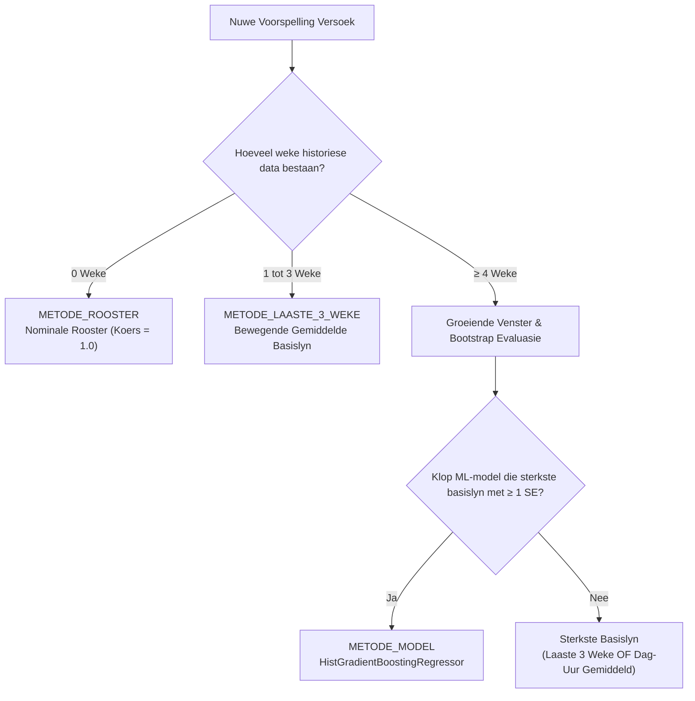

# Lokaalgebruik-Voorspellingsmodel — Tegniese Dokumentasie

> **NSWIW370 · Akademia · Span 3**

Hierdie dokument beskryf die volledige wiskundige ontwerp, dataverwerking, masjienleer-argitektuur, statistiese evaluasie en besigheidslogika agter Akademia se **Lokaalgebruik- en Vulgraadvoorspellingsmodel**.

---

## Oorsig van die Stelsel

Kampusadministrateurs benodig betroubare vooruitskattings van klaskamerbesetting om fasiliteite doeltreffend te bestuur, oorbevolking te verhoed, en botsings vroegtydig te identifiseer.

### Waarom tradisionele roosterdata faal
'n Eenvoudige kyk na die amptelike klasrooster neem aan dat 100% van alle ingeskrewe studente elke lesing bywoon:

$$\text{Rooster-vulgraad} = \frac{\text{Inskrywings}}{\text{Kapasiteit}}$$

In die praktyk toon universiteitsklasse egter aansienlike afwykings:
1. **Semester-verval**: Klasbywoning neem dikwels stelselmatig af soos die semester vorder.
2. **Dag-effekte**: Lesings op Vrydae of Maandagoggende ervaar dikwels laer bywoning as mid-week sessies.
3. **Tydsgleuf-effekte**: Vroegoggend- (08:00) en laatmiddagklasse verskil wesenlik van spits-ure.
4. **Vak-spesifieke gedrag**: Sekere modules behou hoë praktiese bywoning, terwyl ander laer fisiese opdaagsyfers toon.

### Doelwit van die Model
Die model voorspel nie direk 'n arbitrêre studentetal nie, maar modelleer die genormaliseerde **skanderingskoers** $y \in [0.0, 1.0]$:

$$y = \text{clip}\left(\frac{\text{Geskandeerde Studente}}{\text{Ingeskrewe Studente}}, 0.0, 1.0\right)$$

Sodra die verwagte skanderingskoers $\hat{y}$ voorspel is, word die finale bedryfsmetrieke vir enige gegewe sessie bereken:

$$\text{Verwagte Getal} = \text{round}(\hat{y} \times \text{Inskrywing})$$

$$\text{Voorspelde Vulgraad} = \frac{\hat{y} \times \text{Inskrywing}}{\text{Kapasiteit}}$$

---

## 1. Invoerdata & Kenmerk-ontwerp (Feature Engineering)

### Invoerformaat (Weeklikse Kiekie)
Die opleiding aanvaar 'n weeklikse datakiekie met een ry per klassessie per week met die volgende kolomme:
- `Week`: Numeriese weeknommer binne die akademiese semester ($1, 2, \dots$).
- `Sessie`: Unieke sessie-identifiseerder (bv. Klas-ID of saamgestelde sleutel `Vak|Lokaal|Dag|Begin`).
- `Vak`: Modulekode (bv. `PRG310`, `INF201`).
- `Lokaal`: Fisiese lokaalnaam (bv. `LERIBA L4`).
- `Dag`: Dag van die week (Afrikaans of Engels, outomaties genormaliseer).
- `Begin`: Begintyd van die lesing (bv. `08:00` of `08.30`, genormaliseer na `HH:MM`).
- `Inskrywing`: Getal unieke studente wat amptelik vir die klas/module/groep geregistreer is.
- `Kapasiteit`: Maksimum sitplekkapasiteit van die fisiese lokaal.
- `Skanderings`: Werklike unieke NFC-skanderings wat tydens die sessie aangeteken is (slegs vir historiese weke).

### Kenmerkmatriks (`FEATURES`)
Die model transformeer elke sessie na vyf doelgerigte kenmerke:

| Kenmerk | Tipe | Beskrywing | Doel |
|---|---|---|---|
| `Week` | Heelgetal | Semester-weeknommer ($1, 2, \dots, W$) | Vang semester-verval en tydsgebonde tendense vas |
| `DagIndeks` | Kategories (0–6) | $0=\text{Maandag}, \dots, 6=\text{Sondag}$ | Modelleer daaglikse bywoningspatrone (bv. Vrydag-afname) |
| `BeginUur` | Reële getal | Desimale begintyd (bv. $08:30 \to 8.5$) | Vang oggend-, middag- en laatsessies vas |
| `VakHistKoers` | Reële getal $\in [0, 1]$ | Historiese bywoningskoers van daardie spesifieke vak | Spesifieke module-gewoonte sonder datalekkasie |
| `GeskeduleerdeVulgraad` | Reële getal | $\frac{\text{Inskrywing}}{\text{Kapasiteit}}$ | Onderskei tussen oorboekte sale en ruim lokale |

### Streng Voorkoming van Inligtingslekkasie (Data Leakage)
'n Algemene strikdas in bywoningsmodellering is om die vak se totale gemiddeld oor die hele semester te gebruik. Dit sou toekomstige inligting in vroeëre voorspellings inlek.

Om dit te verhoed, word `VakHistKoers` streng kumulatief bereken uit **slegs vorige weke**:

$$\text{VakHistKoers}_{v, w} = \frac{\sum_{i=1}^{w-1} \text{Skanderings}_{v, i}}{\sum_{i=1}^{w-1} \text{Inskrywings}_{v, i}}$$

- Vir **Week 1** is $\text{VakHistKoers} = \text{NaN}$ (geen historiese data beskikbaar nie; HistGradientBoosting hanteer ontbrekende waardes inheems).
- Vir toekomstige teikenweke ($w_{\text{toekoms}} = W + 1$) word die gemiddelde oor alle beskikbare historiese weke $1 \dots W$ as skatting gebruik.

---

## 2. Koue-begin & Basislyn Terugval-hiërargie

Wanneer 'n kampus of semester pas begin, is daar min of geen historiese NFC-data beskikbaar nie. Die stelsel implementeer 'n outomatiese 3-vlak terugval-hiërargie:



### Die Terugvalmetodes:
1. **`METODE_ROOSTER` ("Rooster: geen skanderingsdata nie")**:
   - Gebruik wanneer geen historiese skanderings bestaan nie ($W = 0$).
   - Stel $\hat{y} = 1.0$ (nominale inskrywing).
2. **`METODE_LAASTE3` ("Basislyn: gemiddelde van laaste 3 weke")**:
   - Gebruik wanneer $1 \le W < 4$ weke beskikbaar is, of indien die ML-model misluk.
   - Bereken 'n bewegende gemiddelde oor die jongste 3 weke volgens 'n hiërargiese terugval:
     1. Sessie-spesifieke gemiddeld (indien bekend)
     2. Vak-spesifieke gemiddeld (indien sessie onbekend is)
     3. Globale kampusgemiddeld
3. **`METODE_DAGUUR` ("Basislyn: gemiddelde per dag en uur")**:
   - Bereken die historiese gemiddelde koers vir dieselfde weekdag en begin-uurgleuf (bv. alle Woensdae om 10:00).

---

## 3. Masjienleermodel-argitektuur

Wanneer minstens 4 weke data beskikbaar is, word die hoof-ML-model geaktiveer.

### Algoritme: Histogram-gebaseerde Gradient Boosting
Die model gebruik `HistGradientBoostingRegressor` (uit Scikit-Learn), wat gebaseer is op moderne LightGBM-beginsels. Dit diskretiseer kontinue kenmerke in 256 histogram-emmers, wat opleidingspoed dramaties versnel en uitskieters natuurlik tem.

### Modelkonfigurasie:
```python
HistGradientBoostingRegressor(
    loss="absolute_error",       # L1 verliesfunksie (MAE optimalisasie)
    learning_rate=0.05,          # Konserwatiewe leertempo teen oorpassing
    max_iter=250,                # Maksimum bome in ensemble
    max_leaf_nodes=15,           # Beperkte boom-kompleksiteit
    min_samples_leaf=10,         # Minimum monsters per blaarnoot
    l2_regularization=0.1,       # L2 gewigstraf
    categorical_features=[1],    # DagIndeks word inheems kategories hanteer
    random_state=42,             # Deterministiese herhaalbaarheid
)
```

### Waarom `loss="absolute_error"`?
Standaard kleinste-kwadrate regressie ($L_2$ verlies / MSE) penaliseer groot foute kwadraties. In kampusbywoning kan 'n enkele ongewone gebeurtenis (bv. 'n ewekansige toetsdag met 98% bywoning in 'n klas wat gewoonlik 55% kry) 'n MSE-model heeltemal skeef trek. Deur die absolute fout ($L_1$ norm) te minimaliseer, voorspel die model die robuuste mediaan van bywoning eerder as die gemiddelde.

---

## 4. Eerlike Evaluasie: Groeiende Venster (Expanding Window)

Willekeurige K-voudige kruisvalidasie (K-Fold CV) is ongeldig vir tydreeks- en semesterdata omdat dit toekomstige waarnemings gebruik om verlede waarnemings te voorspel.

Die stelsel gebruik daarom 'n **groeiende venster** (walk-forward validation):
- Vir elke week $k \ge 4$:
  - Lei die model op met weke $1, 2, \dots, k$.
  - Evalueer die model op die ongesiene week $k + 1$.

Alle voorspellings wat so gegenereer word, is streng **uit-voue** (Out-of-Fold / OOF) voorspellings. Geen data van week $k+1$ is ooit tydens die opleiding vir daardie stap gesien nie.

Die gemiddelde absolute fout (MAE) word vir alle metodes op dieselfde uit-voue rye bereken:

$$\text{MAE} = \frac{1}{N} \sum_{i=1}^N |y_i - \hat{y}_i|$$

---

## 5. Statistiese Besluitneming: Gepaarde Bootstrap

'n Fundamentele beginsel van die stelsel is: **'n Masjienleermodel mag slegs ontplooi word as dit statisties bewysbaar beter as 'n eenvoudige basislyn presteer.**

As 'n komplekse model 'n MAE van 0.082 behaal en 'n eenvoudige 3-weke gemiddeld behaal 0.084, kan die verskil bloot ewekansige steuring wees.

### Toetsmetodiek:
1. Identifiseer die sterkste basislyn:
   $$\text{Sterkste Basislyn} = \arg\min (\text{MAE}_{\text{Laaste3}}, \text{MAE}_{\text{DagUur}})$$
2. Bereken die per-sessie absolute foutverskil vir elke toetswaarneming $i$:
   $$d_i = |y_i - \hat{y}_{i, \text{basis}}| - |y_i - \hat{y}_{i, \text{model}}|$$
   *'n Positiewe $d_i$ beteken die ML-model se fout was kleiner as die basislyn s'n.*
3. Voer 'n **gepaarde bootstrap** uit met $B = 2,000$ herhalings:
   - Trek $B$ steekproewe met terugplasing uit die verskilvektor $\mathbf{d}$.
   - Bereken die standaardfout van die gemiddelde verskil: $SE_{\text{bootstrap}} = \text{std}(\bar{d}^*)$.

### Die Keusereël:
Die ML-model word slegs gekies indien:

$$\bar{d} > 0 \quad \text{EN} \quad \bar{d} \ge SE_{\text{bootstrap}}$$

Indien die model nie die sterkste basislyn met ten minste **een volle standaardfout** klop nie, verwerp die stelsel die ML-model outomaties en gebruik die sterkste basislyn. Die presiese rede word in die API-respons gerapporteer (bv. *"Model klop nie basislyn met minstens 1 SE nie; basislyn gekies"*).

---

## 6. Onsekerheid & Voorspellingsintervalle

'n Enkele puntskatting (bv. "daar sal 45 studente wees") is onvoldoende vir kapasiteitsbeplanning. Administrateurs moet weet of daar 'n risiko van oorloop bestaan.

### Berekening van Voorspellingsgrense
Die stelsel ontleed die historiese uit-voue residue:

$$r_i = y_i - \hat{y}_i$$

Die 10% en 90% empiriese kwantiele word bereken:
- $q_{lo} = \text{Quantile}_{0.10}(r)$ (tipies 'n negatiewe getal)
- $q_{hi} = \text{Quantile}_{0.90}(r)$ (tipies 'n positiewe getal)

Die 80% voorspellingsinterval vir die komende week is:

$$koers_{\text{laag}} = \text{clip}(\hat{y} + q_{lo}, 0.0, 1.0)$$

$$koers_{\text{hoog}} = \text{clip}(\hat{y} + q_{hi}, 0.0, 1.0)$$

### Eerlike Dekkingstoets (Empirical Coverage Check)
Voorspellingsintervalle kan misleidend wees as hulle te smal is. Om die gebruiker te beskerm, toets die stelsel die werklike historiese dekking:

$$\text{Dekking} = \frac{1}{N} \sum_{i=1}^N \mathbb{I}(q_{lo} \le r_i \le q_{hi})$$

- **Reël**: Die voorspellingsreeks word slegs op die webpaneel vertoon indien die gemete dekking minstens 70% is:
  $$\text{Dekking} \ge 0.70 \quad (\text{met teikendekking } \approx 80\%)$$
- Indien die dekking onder 70% val (bv. weens uiterste variansie), word die reeks outomaties versteek en slegs die puntskatting vertoon.

---

## 7. Besigheidsreëls & Koppelvlak-integrasie

### Waarskuwingsvlae
Vir elke sessie in die weekrooster evalueer die stelsel drie belangrike operasionele vlae:

| Vlag | Toets | Betekenis |
|---|---|---|
| `oor_kapasiteit` | $\text{Vulgraad} > 1.0$ ($> 100\%$) | Die mees waarskynlike studentetal oorskry die lokaal se kapasiteit. |
| `kan_oorloop` | $reeks[\text{vulgraad\_hoog}] > 1.0$ | Die boonste 90%-grens oorskry die kapasiteit; risiko van oorloop. |
| `konflik` | $Begin_A < Einde_B \land Begin_B < Einde_A$ | Twee verskillende klasse is geskeduleer in dieselfde lokaal op dieselfde tyd. |

### Visuele Kleurkodering (Webwerf)
Op die interaktiewe rooster (`Webwerf/kampus.html`) word sessies dinamies gekleur volgens hul voorspelde vulgraad:
- **Groen** ($\le 50\%$): Lae besetting / ruim lokaal.
- **Geel** ($51\% - 80\%$): Gesonde, gebalanseerde besetting.
- **Pers / Aksent** ($81\% - 100\%$): Optimale lokaalbenutting.
- **Rooi** ($> 100\%$): Oorbevolking / lokaal te klein.
- **⚠ Waarskuwingsikoon**: Dui op 'n lokaalkonflik of kapasiteitsoorskryding.

### API-eindpunte
- **`GET /lokaalgebruik/voorspellings?kampus_id={id}&dag={dag}`**:
  Lewer die volledige lokaalmatriks vir die gekose kampus en dag, insluitend sessies, verwagte getalle, vulgrade, reekse en waarskuwingsvlae.
- **`GET /lokaalgebruik/ml-status`**:
  Lewer diagnostiese inligting oor die model: tans gekose metode, MAE-metrieke, bootstrap-verskil, reeks-dekking en opleidingsgeskiedenis.

### Outomatiese Opleiding & Instandhouding
- Tydens Docker-opstart voer `Backend/entrypoint.sh` outomaties `scripts/bootstrap_lokaalgebruik_ml.py` uit.
- Die skrip verseker dat lokale en klaskoppelinge gekarteer is, genereer sintetiese data indien nodig, lei die model op, evalueer teen basislyne, en stoor die finale modelbundel na `ml_models/lokaalgebruik_model.joblib`.
- As die modelbundel nie beskikbaar is nie, skakel die API soepel terug na `METODE_ROOSTER` sonder dat die bediener faal.
